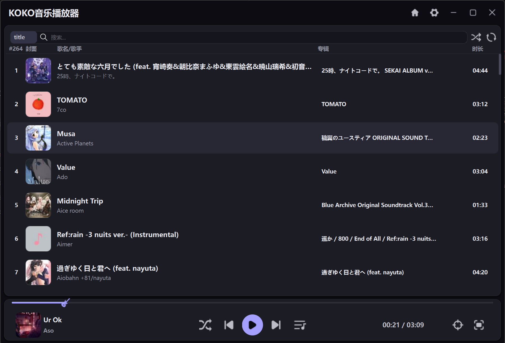
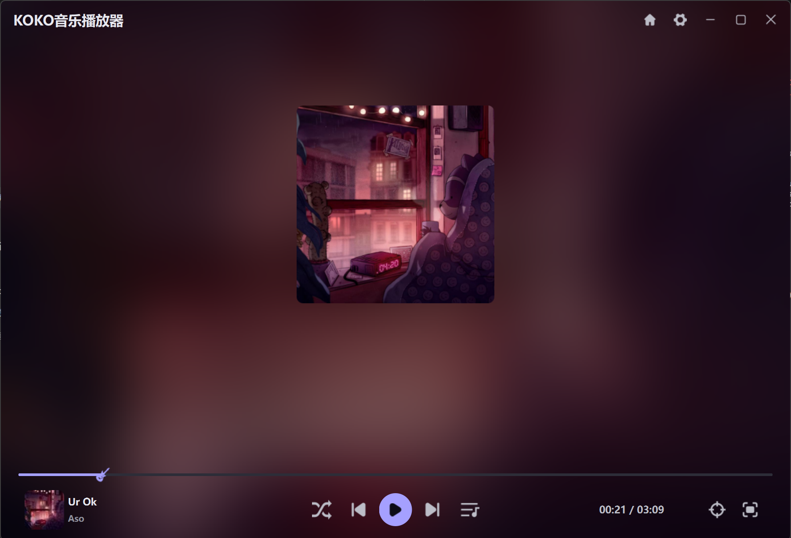
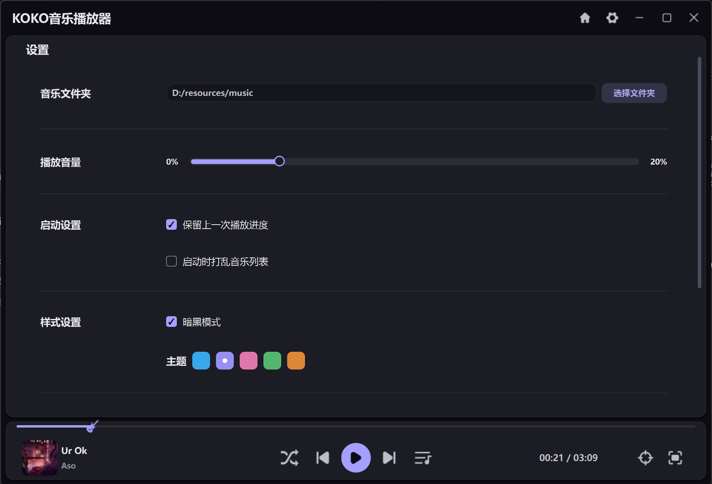

# KOKO 音乐播放器

一个在本地播放自己收藏的音乐的桌面播放器。界面干净、好看，该有的都有：音乐库、搜索、播放列表、沉浸模式和主题切换。



## 界面一览

### 音乐库主页

左侧是歌曲列表，右侧是底部常驻的播放控制栏。

- **列表**：显示序号、封面、歌名 / 歌手、专辑、时长。双击任意一首歌开始播放，正在播放的那一行会高亮。
- **搜索**：支持按 **歌名 / 歌手 / 专辑** 三种字段检索，输入后回车或点放大镜即可。
- **打乱列表**：顶部右侧的交叉箭头按钮会把音乐库顺序打乱。
- **底部播放栏**：左侧是当前歌曲的封面、标题和歌手；中间是播放模式、上一首、播放 / 暂停、下一首、播放列表五个按钮；右侧是进度时间、定位当前歌曲、沉浸模式。
- **进度条**：细长的一条，上面的小图标就是播放位置，可以直接点击进度条跳到任意位置。

### 沉浸模式

点底部右侧的沉浸模式按钮，进入全屏欣赏页面：



- 用当前歌曲封面放大模糊做成背景，可以调节**明暗度**和**模糊度**。
- 中间是封面，底部是实时**音频频谱**，会跟着音乐跳动。
- 全景模式下背景铺满整个窗口；也可以只保留居中的封面，让背景安静一点。
- 播放控制依然保留在底部，进度条和按钮都还在。

### 设置

点标题栏的齿轮进入设置页：



- **音乐文件夹**：选择存放音乐的目录，自动扫描并读取歌曲信息与内嵌封面。
- **播放音量**：拖动滑块调节音量。
- **启动设置**：可以选择「保留上一次播放进度」和「启动时打乱音乐列表」。
- **样式设置**：切换**暗黑模式**，以及在 **天蓝 / 藤紫 / 樱粉 / 苔绿 / 琥珀** 五种主题色之间切换。主题色会同时影响按钮、进度条、选中行和频谱颜色。
- **沉浸模式设置**：全景模式开关，以及背景明暗度、背景模糊度、频谱衰减速率。

## 播放列表

点底部播放栏的「播放列表」按钮，右侧会滑出一个浮动面板：

- 列表显示封面、歌名、歌手和时长。
- 正在播放的歌曲高亮显示。
- 双击任意一首歌即可切歌。
- 点击面板外的区域可以收起。

## 功能速览

| 功能 | 说明 |
| --- | --- |
| 本地音乐库 | 扫描本地文件夹，支持 MP3 / FLAC，读取标题、歌手、专辑、时长和封面 |
| 搜索 | 按歌名、歌手、专辑检索 |
| 打乱列表 | 一键随机排列音乐库顺序 |
| 播放模式 | 顺序播放 / 随机播放 / 单曲循环 |
| 进度控制 | 点击进度条跳转，播放位置用小图标标出 |
| 浮动播放列表 | 侧滑面板，当前歌曲高亮，双击切歌 |
| 定位当前歌曲 | 一键在长列表里找到正在播放的那一首 |
| 沉浸模式 | 封面模糊背景 + 实时频谱，背景亮度与模糊度可调 |
| 主题 | 明亮 / 暗黑两套配色，五种主题色 |
| 记忆播放状态 | 记住播放进度与音量，下次打开接着听 |

## 关于界面

- 无边框窗口，标题栏自绘：首页、设置、最小化、最大化、关闭。
- 所有界面元素都跟随当前主题换色，切换主题是即时的，不用重启。
- 列表、卡片、播放列表都做了圆角处理，暗色下也保持柔和的层次感。

## 运行

需要 Python 3.12 及以上，安装依赖后从入口文件启动：

```bash
uv sync
uv run python src/App.py
```
